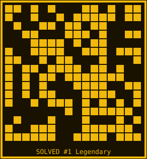

# SOLVED Genesis

SOLVED Genesis is a free mint on BNB Chain: every `.ai` Agent ID wallet gets its own on-chain 3-SAT puzzle and mints by submitting a solution. Gas only, max 2 per wallet, supply 2,048.

- Contract: `0x4f1bE6E4c73138D706853584BA0Fa4cB923Dcd95` (Sourcify exact_match, no server, no signer, no owner)
- Mint page: https://hark.site/s/ce3839f6-687d-4389-ba3f-52fac798652e
- Element: https://element.market/collections/solved-genesis
- AgentIDHub: https://agentidhub.eth.limo/project.html?id=solved-genesis (Active, Low risk)

The logo above is SOLVED #1, Legendary — the winning 16x16 assignment grid (SAT 960/960), taken from the NFT contract's own tokenURI.

## About $SLVD

$SLVD is a separate community token for SOLVED Genesis. It is **NOT required to mint SOLVED** — minting stays gas only, because the NFT contract has no owner to change that.

Planned community use, off-chain, not enforced by the NFT contract:
1. Solver rewards for wallets that actually solved and minted, verified from on-chain mint events
2. Leaderboard seasons for solvers
3. Community votes on future puzzle-season themes

No price promise, no revenue share, no guaranteed airdrop amount, no fake roadmap.

## Disclosure

This NFT contract was made by the project creator, and the creator's wallet holds SOLVED #1 and #2.
